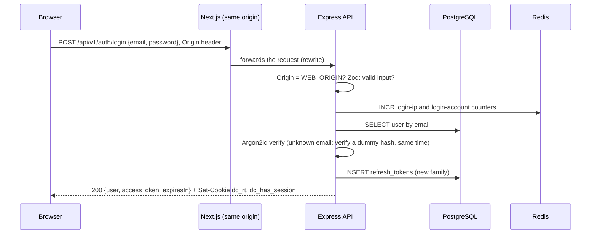
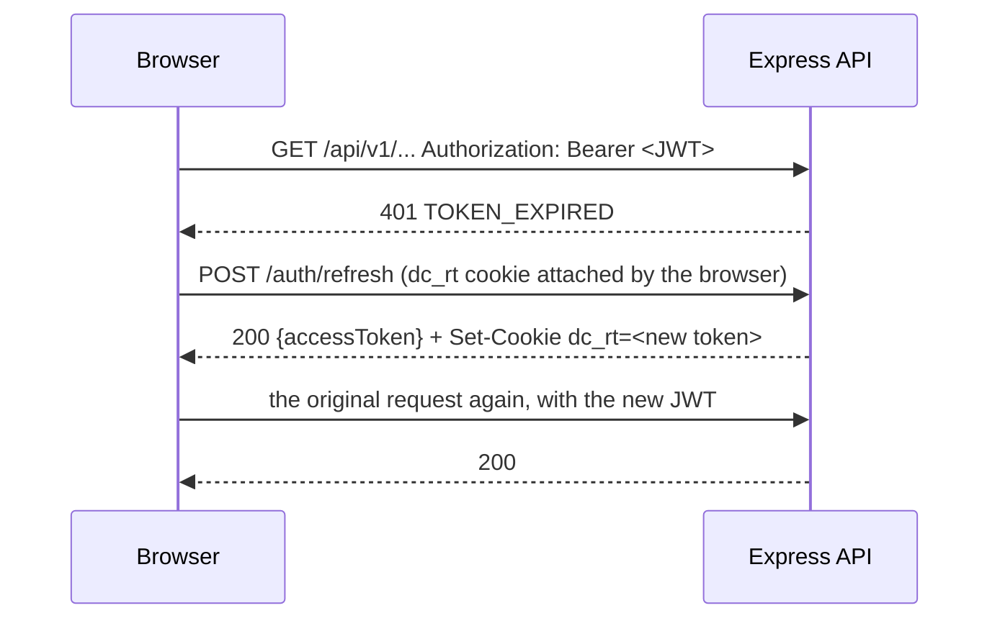
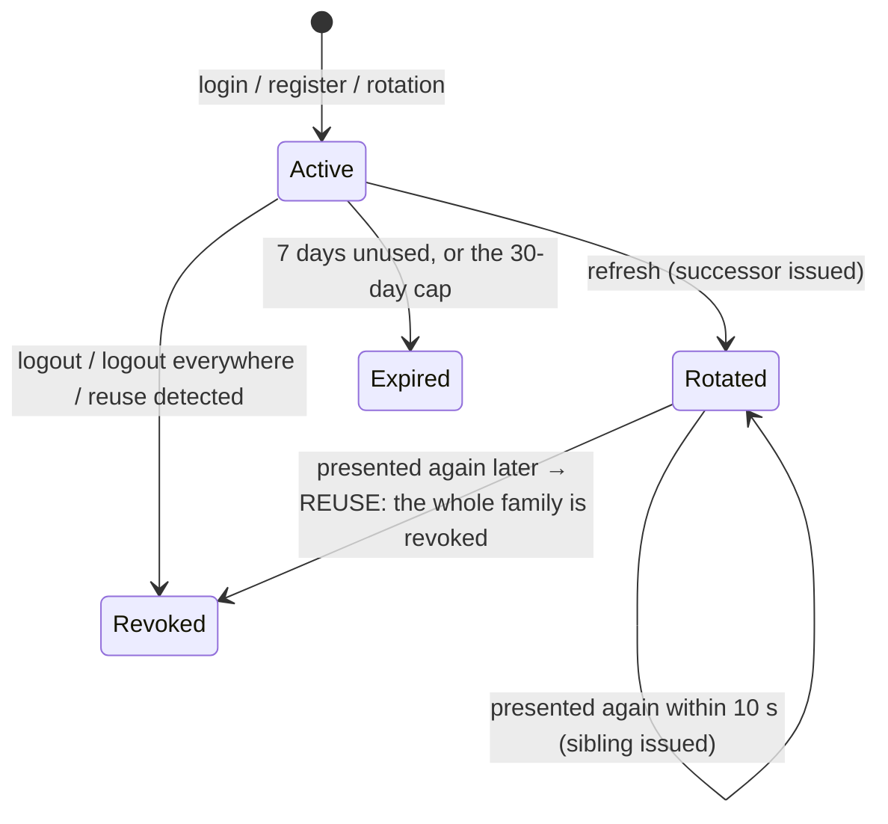

# Authentication

How DevConnect knows who is calling, how sessions start, stay alive and end, and what each piece
defends against. The decisions behind it: [ADR 0006](adr/0006-auth-tokens-and-api-proxy.md) (tokens
and the API proxy), [ADR 0011](adr/0011-refresh-token-rotation.md) (refresh-token rotation) and
[ADR 0012](adr/0012-fixed-window-login-rate-limiting.md) (rate limiting). Endpoint details:
[api.md](api.md).

## Two credentials

|                            | Access token                                            | Refresh token                                                            |
| -------------------------- | ------------------------------------------------------- | ------------------------------------------------------------------------ |
| What it is                 | a JWT, HMAC-SHA256 signed (`alg: HS256`, `typ: at+jwt`) | 32 random bytes (43 characters, base64url)                               |
| Lifetime                   | 15 minutes (`JWT_ACCESS_TTL_SECONDS`)                   | 7 days without use, 30 days per login at most                            |
| Where the browser keeps it | a JavaScript variable (lost on reload)                  | the `dc_rt` cookie: HttpOnly, Secure, SameSite=Strict, Path=/api/v1/auth |
| Sent as                    | `Authorization: Bearer <token>`                         | automatically, by the browser, to /api/v1/auth only                      |
| Checked by                 | the signature and `exp` (no database query)             | a row in `refresh_tokens` (only its SHA-256 is stored)                   |
| Can it be revoked?         | no: it expires                                          | yes: logout, logout everywhere, reuse detection                          |

The access token is fast to check, so it guards every request. The refresh token is revocable, so it
carries the long-lived session. Neither is ever stored in `localStorage`.

## The flows

### Sign up, sign in

Registration is the same, except that it hashes the password and inserts the user, their profile and
the first refresh token in one transaction. The `UNIQUE` indexes decide whether an email or a
username is taken (no "check first, then insert" race), and the API translates their error into
`409 EMAIL_TAKEN` or `409 USERNAME_TAKEN`.

### Calling the API, refreshing on expiry

The web app also refreshes a minute before the token expires, so a 401 is the exception. On a page
load the in-memory token is gone, and the app calls `/auth/refresh` to get a new one, but only if
the readable `dc_has_session` cookie says there is a refresh cookie to use: visitors who aren't
signed in cost no request at all.

### Rotation and reuse detection

Every refresh token works once. Its lifecycle:

Why reuse means theft: once a token has been rotated, its legitimate holder moved on to the
successor. If the old token comes back, someone else has a copy. The API can't tell the user from
the thief, so it ends the session for both (the user signs in again, the thief can't). The details,
including why revocation is checked for the whole family when a token is used, are in ADR 0011.

## Passwords

- **Rules** (`packages/shared/src/password-policy.ts`, NIST SP 800-63B-4): 15 to 128 characters,
  counted in Unicode code points; no "must contain a symbol" rules; rejected if too easy to guess.
  "Too easy" means fewer than 8 characters remain after removing keyboard walks and runs (`qwerty`,
  `12345`, `1qaz2wsx`), repeated characters or chunks, words that mean "password" (even as
  `p@ssw0rd`) and the person's own name, username and email. The same code runs in the browser
  (instant feedback) and in the API (the actual rule).
- **Storage** (`apps/api/src/modules/auth/password.ts`): Argon2id with 19 MiB of memory, 2 passes, 1
  lane, a random 16-byte salt per password. The memory cost is what hurts attackers: guessing in
  parallel on a GPU needs 19 MiB per guess. Passwords are normalised (NFKC) before hashing, so one
  password typed on two keyboards hashes the same.
- **Parameter upgrades:** each hash records its parameters. If they change, the next successful
  login re-hashes the password with the new ones.
- **Unknown emails** take as long as wrong passwords: the API verifies the password against a dummy
  hash and returns the same 401. Otherwise response times would reveal which emails have accounts.
  (Registration does reveal it with `EMAIL_TAKEN`; that's a deliberate usability trade-off, slowed
  down by the sign-up limit.)

## Threats and defences

| Threat                                                 | Defence                                                                    | Where                                         | Tested in                                                |
| ------------------------------------------------------ | -------------------------------------------------------------------------- | --------------------------------------------- | -------------------------------------------------------- |
| Stolen database backup used to sign in                 | passwords: Argon2id; refresh tokens: only SHA-256 stored                   | `password.ts`, `tokens.ts`                    | `password.test.ts`, `auth.test.ts`                       |
| XSS script steals the session                          | refresh token in an HttpOnly cookie; access token in memory, 15 min        | `refresh-cookie.ts`, `web/src/lib/session.ts` | browser walkthrough (`document.cookie` shows no `dc_rt`) |
| CSRF: another site triggers a request with your cookie | SameSite=Strict + `Origin` check on the cookie endpoints; JSON-only bodies | `require-trusted-origin.ts`                   | `auth.test.ts` (403 cases)                               |
| Forged or tampered JWT, `alg: none`, wrong algorithm   | `algorithms: ['HS256']`, issuer, audience and `typ` checked                | `tokens.ts`                                   | `tokens.test.ts`                                         |
| Replayed (stolen) refresh token                        | rotation + reuse detection revokes the family                              | `auth.service.ts`, `auth.repository.ts`       | `auth.test.ts` (reuse)                                   |
| Logout racing a refresh                                | revocation checked per family, at use time                                 | `auth.repository.ts`                          | `auth.test.ts` (straggler token)                         |
| Password guessing, credential stuffing                 | 10 attempts / 15 min per account, 50 per IP                                | `lib/rate-limit.ts`                           | `auth.test.ts`, `rate-limit.test.ts`                     |
| Account enumeration through login                      | same message, same status, same Argon2 work                                | `auth.service.ts`                             | `auth.service.test.ts`, `auth.test.ts`                   |
| Open redirect via `/login?next=`                       | URL resolved, then its origin compared                                     | `web/src/lib/auth.ts`                         | `web/src/lib/auth.test.ts`                               |
| Secrets in logs                                        | events carry ids only; pino redacts auth headers and cookies               | `auth.controller.ts`, `lib/logger.ts`         | review                                                   |

## Security events in the logs

| Event                        | Level | Fields                                                             |
| ---------------------------- | ----- | ------------------------------------------------------------------ |
| `auth.registered`            | info  | `userId`                                                           |
| `auth.logged_in`             | info  | `userId`                                                           |
| `auth.login_failed`          | warn  | `reason` (`unknown_email` / `wrong_password`), `userId` when known |
| `auth.refresh_grace`         | info  | `userId` (a token refreshed twice within 10 s)                     |
| `auth.refresh_token_reused`  | warn  | `userId`, `sessionId`: possible theft, the session was revoked     |
| `auth.logged_out_everywhere` | info  | `userId`, number of tokens revoked                                 |

Never logged: emails, passwords, tokens, cookies, IP addresses.

## Known limitations and next steps

- Access tokens can't be revoked before they expire (up to 15 minutes after logout). A Redis
  deny-list of ended sessions (`sid`) would close that gap, at the cost of a lookup per request.
- The fixed window allows bursts of up to 2× the limit at a window boundary (Phase 12: token bucket).
- Leaked-password checking (Pwned Passwords range API) and IPv6 /64 grouping for the per-IP limit
  come in Phase 12.
- No email verification or password reset yet (both need an email service).

## Measurements

On the development machine (Windows 11, Docker Desktop). Nothing is claimed until it's measured.

| Metric                                              | Value          |
| --------------------------------------------------- | -------------- |
| Argon2id hash, median of 20 (`pnpm bench:password`) | To be measured |
| Argon2id verify, median of 20                       | To be measured |
| Verifications per second, 32 at once                | To be measured |
