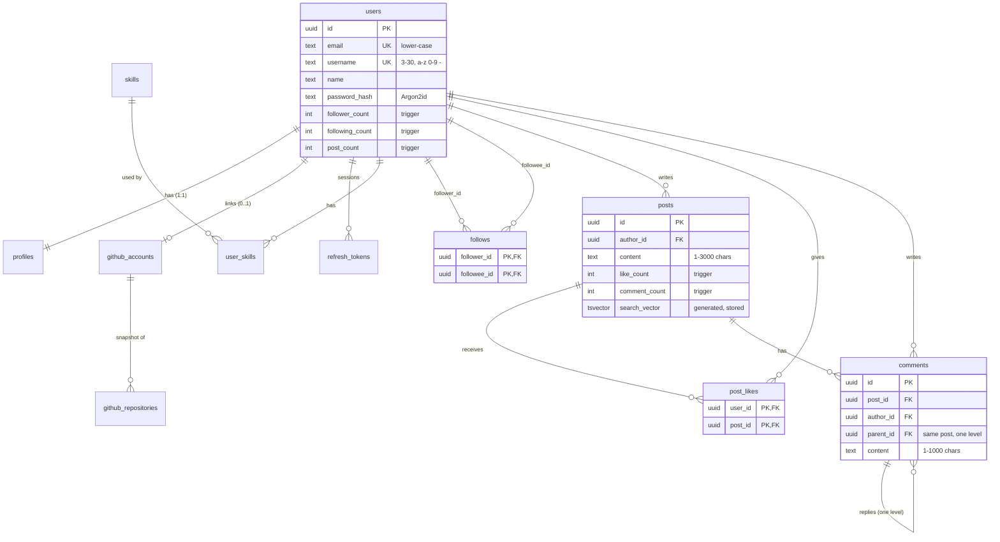

# Database

PostgreSQL 18, accessed through Drizzle ORM's SQL-like query builder (ADR 0005). The schema lives in
`apps/api/src/db/schema/`, migrations in `apps/api/src/db/migrations/`.

## Entity-relationship diagram



## Tables

| Table                                    | Holds                                                   | Notable rules                                                               |
| ---------------------------------------- | ------------------------------------------------------- | --------------------------------------------------------------------------- |
| `users`                                  | identity + the fields shown on every post card          | unique lower-case email; username format; counters ≥ 0                      |
| `profiles`                               | headline, bio, links, experience and education (JSONB)  | http(s)-only portfolio link; ≤ 20 experience/education entries              |
| `skills`, `user_skills`                  | shared skill vocabulary; who has which skill, in order  | ≤ 20 skills per user (positions 0–19, unique per user)                      |
| `follows`                                | who follows whom                                        | composite primary key; no self-follow                                       |
| `posts`                                  | posts and their counters                                | 1–3,000 characters, not blank; image URL and id together                    |
| `post_likes`                             | one row per (user, post)                                | composite primary key: a second like is impossible                          |
| `comments`                               | comments and one level of replies                       | reply on the same post (composite FK); replies to replies blocked (trigger) |
| `github_accounts`, `github_repositories` | a linked GitHub account and its repo snapshot (Phase 5) | one GitHub account per user, one user per GitHub account                    |
| `refresh_tokens`                         | one row per issued refresh token (ADR 0011)             | only SHA-256 hex digests are stored, never raw tokens                       |

Conventions (ADR 0009): `uuid DEFAULT uuidv7()` keys, `timestamptz(3)` timestamps, `text` + named
`CHECK` constraints, `ON DELETE CASCADE` on every foreign key.

## Where each rule is enforced

| Rule                                     | API                                                | Database                                          |
| ---------------------------------------- | -------------------------------------------------- | ------------------------------------------------- |
| Field formats and lengths                | Zod (shared with the web forms): friendly messages | `CHECK`: the guarantee                            |
| Unique email / username / like / follow  | translates 23505 into `EMAIL_TAKEN`, ... (409)     | `UNIQUE`, primary keys                            |
| Ownership ("only the author may edit")   | `WHERE author_id = $me` in the query               | —                                                 |
| Counters                                 | never written by the API                           | statement-level triggers (ADR 0010)               |
| Cleanup when a user/post is deleted      | —                                                  | `ON DELETE CASCADE`                               |
| Reserved usernames (admin, support, ...) | `RESERVED_USERNAMES` in `packages/shared`          | — (`me` is impossible anyway: 3-char minimum)     |
| A session is revoked                     | checks the whole family at use time (ADR 0011)     | partial index `refresh_tokens_revoked_family_idx` |

## Indexes and the queries they serve

Plans below are from a verification run (Linux, PostgreSQL 18.6) on 10,000 users and 100,000
posts generated with `pnpm db:seed:large`; the development machine's numbers are under
[Measurements](#measurements). "Buffers" counts the 8 kB pages read: it shows how much work a
query does, independent of how fast the machine is.

| Query                                                              | Index                                         | Plan                                              | Buffers |
| ------------------------------------------------------------------ | --------------------------------------------- | ------------------------------------------------- | ------- |
| Explore, first page (`ORDER BY created_at DESC, id DESC LIMIT 21`) | `posts_created_idx`                           | Index Only Scan                                   | 4       |
| Explore, next page (keyset: `WHERE (created_at, id) < (…)`)        | `posts_created_idx`                           | Index Only Scan                                   | 4       |
| Explore, page 2,000 with `OFFSET 40000`                            | `posts_created_idx`                           | Index Only Scan, 40,021 rows read and thrown away | 426     |
| Profile timeline (`WHERE author_id = …`)                           | `posts_author_created_idx`                    | Index Only Scan                                   | 4       |
| Comment thread (`WHERE post_id = … AND parent_id IS NULL`)         | `comments_post_created_idx`                   | Index Scan + filter                               | 4       |
| Followers list of the most-followed user                           | `follows_followee_created_idx`                | Index Only Scan                                   | 4       |
| "Which of these 20 posts did I like?"                              | `post_likes_pkey`                             | Index Only Scan                                   | 3       |
| Full-text search (`search_vector @@ websearch_to_tsquery(…)`)      | `posts_search_vector_idx` (GIN)               | Bitmap Index Scan                                 | 54      |
| "Has this session been revoked?" (every refresh, lesson 4)         | `refresh_tokens_revoked_family_idx` (partial) | Index Only Scan                                   | 2       |

Reproduce any of them with `pnpm db:psql` and `EXPLAIN (ANALYZE, BUFFERS) <query>;`.

### Lesson 1: an index only replaces a sort if its NULL ordering matches

In Postgres, `ORDER BY created_at DESC` means `DESC NULLS FIRST`. Drizzle's `.desc()` in an index
definition writes `DESC NULLS LAST`. Same column, same direction, but the planner can't use that
index for the default ordering. Measured on 50,000 posts:

```
-- index created as (created_at DESC NULLS LAST, id DESC NULLS LAST)
EXPLAIN SELECT id FROM posts ORDER BY created_at DESC, id DESC LIMIT 20;
  Limit  (cost=2839.48..2839.53 rows=20)
    ->  Sort  (Sort Key: created_at DESC, id DESC)
          ->  Seq Scan on posts  (rows=50000)

-- the same query once the index matches (DESC NULLS FIRST, what the schema uses now)
  Limit  (cost=0.29..1.92 rows=20)
    ->  Index Only Scan using posts_created_idx on posts
```

The fix is `.desc().nullsFirst()` in the schema. The columns are `NOT NULL`, yet the planner still
requires the orderings to match.

### Lesson 2: Postgres doesn't index foreign keys for you

Deleting a post makes Postgres find its likes and comments (`ON DELETE CASCADE`). Without an index
on `post_likes.post_id`, that is a full scan of every like, for every deleted post. Every foreign key
column here leads some index. And `comments (post_id, …)` is deliberately not a partial index
(`WHERE parent_id IS NULL`): the cascade must find replies too.

### Lesson 3: the planner skips an index that wouldn't help

On the generated data, a trigram search for `load-usr-123` used a sequential scan: every generated
username starts with `load-user-`, so nearly every row is "similar" and reading the whole table is
cheaper. Indexes pay off for selective conditions. Phase 11 revisits this with realistic names.

### Lesson 4: a partial index for a question about rare rows

Every token refresh asks whether any token of the session has been revoked (ADR 0011):

```sql
select exists (
  select 1 from refresh_tokens r where r.family_id = $1 and r.revoked_at is not null
);
```

Measured in the verification run (12 runs) on 202,891 tokens: one 30-day session of 2,880 tokens
(one per 15-minute refresh, none revoked) among 20,000 sessions of 10 tokens, one session in ten
revoked. The question was asked about the long session:

| Indexes available                                       | Plan the planner chose         | Rows read and thrown away | Buffers | Time         |
| ------------------------------------------------------- | ------------------------------ | ------------------------- | ------- | ------------ |
| `refresh_tokens_revoked_family_idx` (only revoked rows) | Index Only Scan (every run)    | 0                         | 2       | ≈ 0.01 ms    |
| `refresh_tokens_family_idx` only                        | Index Scan + filter (10 of 12) | 2,880                     | 72–73   | 0.37–0.72 ms |
| `refresh_tokens_family_idx` only                        | Seq Scan (2 of 12)             | 202,891                   | 4,513   | 21.7 ms      |

Two lessons in one table:

1. **A partial index holds only the rows a query asks about** (`WHERE revoked_at IS NOT NULL`), so
   the answer costs two pages however many tokens the table and the session accumulate. Without it,
   Postgres has to read every token of the session to prove that none is revoked. Migration `0003`
   adds it.
2. **Why the planner sometimes read the whole table.** It estimated 2,800 tokens for this session
   (right) and 278 revoked among them (wrong). It assumes columns are independent: 10% of all tokens
   are revoked, so 10% of this session's should be. `EXISTS` stops at the first match, and with 278
   expected matches a sequential scan "should" find one after reading about 1/279 of the table
   (estimated cost 25, slightly below the index's). There were none, so it read all 202,891 rows.
   Which plan wins depends on statistics that `ANALYZE` takes from a random sample and on the
   table's physical layout, so it can change from one run to the next. The partial index makes the
   cost small and predictable. (Extended statistics, `CREATE STATISTICS`, are the general tool for
   telling the planner about correlated columns.)

Reproduce it with `pnpm db:psql` (after `pnpm db:migrate` and `pnpm db:seed`). Everything runs in a
transaction and is rolled back, so no data is kept:

```sql
begin;
select id as uid from users order by created_at limit 1 \gset
select uuidv7() as fam \gset
-- one 30-day session: 2,880 tokens, all but the newest rotated, none revoked
insert into refresh_tokens (user_id, family_id, token_hash, expires_at, family_expires_at, rotated_at)
select :'uid', :'fam', encode(sha256(('long-' || g)::bytea), 'hex'),
       now() + interval '7 days', now() + interval '30 days', case when g < 2880 then now() end
from generate_series(1, 2880) g;
-- 20,000 other sessions of 10 tokens; every 10th session revoked
insert into refresh_tokens (user_id, family_id, token_hash, expires_at, family_expires_at, revoked_at)
select :'uid', f.id, encode(sha256(('other-' || f.n || '-' || t)::bytea), 'hex'),
       now() + interval '7 days', now() + interval '30 days', case when f.n % 10 = 0 then now() end
from (select uuidv7() as id, n from generate_series(1, 20000) n) f, generate_series(1, 10) t;
analyze refresh_tokens;
explain (analyze, buffers)
select exists (select 1 from refresh_tokens r where r.family_id = :'fam' and r.revoked_at is not null);
drop index refresh_tokens_revoked_family_idx; -- only inside this transaction
explain (analyze, buffers)
select exists (select 1 from refresh_tokens r where r.family_id = :'fam' and r.revoked_at is not null);
rollback;
```

## Triggers

Migration `0002_counters_and_rules.sql`:

- **Counters** (`posts.like_count`, `posts.comment_count`, `users.post_count`,
  `users.follower_count`, `users.following_count`): statement-level triggers with transition
  tables. Why: ADR 0010.
- **One level of replies:** a `BEFORE INSERT` trigger on `comments` raising error 23514 with the
  constraint name `comments_one_reply_level`.

## Changing the schema

1. Edit the tables in `apps/api/src/db/schema/`.
2. `pnpm db:generate`: drizzle-kit writes a new SQL file into `apps/api/src/db/migrations/`.
   For things drizzle-kit can't express (triggers, extensions):
   `pnpm --filter @devconnect/api exec drizzle-kit generate --custom --name <what>`, then write SQL.
3. Read the generated SQL. It's what will run in production.
4. `pnpm db:migrate` applies it locally; `pnpm test:integration` applies all migrations to an empty
   test database and runs the tests.
5. Commit the schema change and the migration together. CI fails if they disagree.

Never edit a migration that has already run somewhere other than your machine; add a new one.
In production, migrations run before the new API version starts, so each one must also work with
the code that is still running ("expand, then contract": add the new column, deploy, then remove the
old one).

## Seed data

| Command                              | What you get                                                                                                                                |
| ------------------------------------ | ------------------------------------------------------------------------------------------------------------------------------------------- |
| `pnpm db:seed`                       | 8 fictional developers with profiles, skills, posts, likes, comments and follows. Password for every account: `seed-password-for-local-dev` |
| `pnpm db:seed:large`                 | 10,000 users, 100,000 posts, ~480,000 follows, ~300,000 likes, 100,000 comments                                                             |
| `pnpm db:seed:large --posts 1000000` | the size for the Phase 9 feed benchmark                                                                                                     |

Both replace all data and refuse to run against anything but a database on this machine.
`db:seed:large` prints each step's duration and the final table sizes.

## Measurements

Measured on the development machine: Windows 11, Docker Desktop (WSL 2), PostgreSQL 18.6
(`postgres:18-alpine`), 2026-11-08. These are single runs unless noted: repeat a measurement and
report the median before quoting it anywhere. Nothing is claimed until it is measured.

### `pnpm db:seed:large` (10,000 users, 100,000 posts)

| Step                                             | Rows    | Time        | Per row |
| ------------------------------------------------ | ------- | ----------- | ------- |
| Follows                                          | 477,819 | 43.0 s      | 90 µs   |
| Likes                                            | 299,974 | 31.8 s      | 106 µs  |
| Comments                                         | 100,000 | 12.8 s      | 128 µs  |
| Posts                                            | 100,000 | 7.2 s       | 72 µs   |
| Everything else (users, skills, VACUUM, recount) |         | 5.5 s       |         |
| **Total**                                        |         | **100.3 s** |         |

Comments cost the most per row: five index entries, two foreign-key checks and the reply-depth
trigger for every row. Likes and comments also rewrite post rows through the counter triggers.

| Table        | Table data | Indexes |
| ------------ | ---------- | ------- |
| `follows`    | 31 MB      | 94 MB   |
| `posts`      | 74 MB      | 38 MB   |
| `post_likes` | 20 MB      | 30 MB   |
| `comments`   | 12 MB      | 20 MB   |

`follows` has three times more index than data: each row is two ids and a timestamp, and three
indexes each store a copy of those columns. Each post was written three times (insert, then one
rewrite per counter trigger); VACUUM makes the old copies' space reusable but doesn't shrink the
file.

### Pagination: page 2,000 of the explore timeline

| Query                                           | Pages read (buffers)               | Execution time |
| ----------------------------------------------- | ---------------------------------- | -------------- |
| `LIMIT 21 OFFSET 40000`                         | 444 (345 from cache, 99 from disk) | 210.1 ms       |
| Keyset: `WHERE (created_at, id) < (…) LIMIT 21` | 4 (all from cache)                 | 0.31 ms        |

Pages read is the fair comparison: 444 / 4 = 111 times more work for OFFSET, because it reads and
discards 40,000 index entries. The times aren't comparable: the OFFSET query ran first after a
Postgres restart (cold cache, 99 pages from disk), the keyset query ran warm.

### Other

| Metric                                              | Value                     |
| --------------------------------------------------- | ------------------------- |
| Integration test suite (49 tests, Phase 2)          | 10.9 s, 11.1 s (two runs) |
| Integration test suite (83 tests, Phase 3)          | To be measured            |
| CI pipeline, Phase 2 (PR #1, GitHub Actions)        | 54 s                      |
| Revoked-session check on your machine (lesson 4)    | To be measured            |
| `pnpm db:seed:large --posts 1000000` total time     | To be measured            |
| Size of `posts` at 1,000,000 posts                  | To be measured            |
| OFFSET vs keyset time, warm cache, median of 5 runs | To be measured (Phase 9)  |
